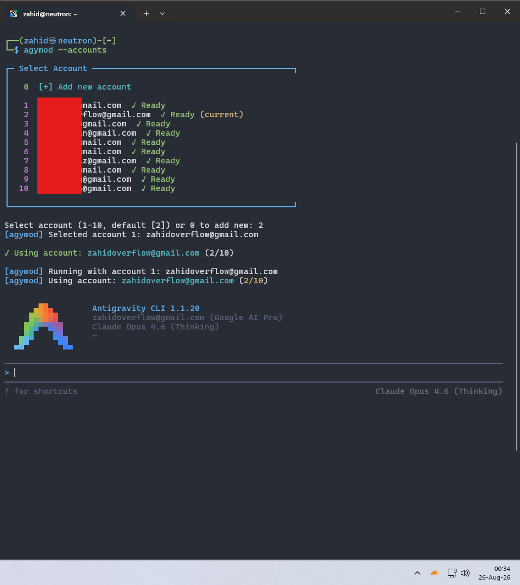
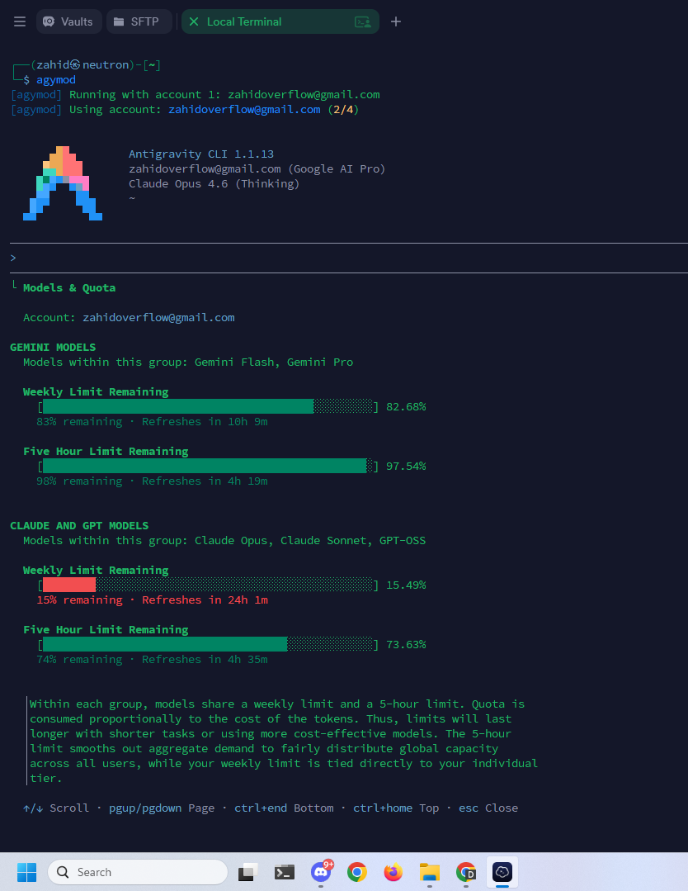

#  agymod

> Multi-account Antigravity CLI manager with automatic quota rotation

[](https://opensource.org/licenses/MIT)
[](https://www.gnu.org/software/bash/)
[](https://github.com/zahidoverflow/agymod)

**agymod** is a lightweight, open-source account manager for Antigravity CLI (`agy`) that automatically rotates between multiple Google accounts when quota limits are reached. Work uninterrupted through API rate limits with seamless, cryptographically verified account switching.

## 📸 Preview

### Interactive Account Selector (`agymod --accounts`)


### Quota & Model Status Monitor


---

## 🎯 Problem

Antigravity CLI (`agy`) enforces a **5-hour rolling quota and a weekly quota per Google account**. During extended work sessions:
- ❌ You hit quota and work stops
- ❌ Manual account switching breaks your workflow
- ❌ Managing multiple accounts and desktop keyring state is tedious
- ❌ Long sessions become interrupted

## ✅ Solution

**agymod** provides:
- ✅ Automatic account rotation & instant re-launch on quota
- ✅ Interactive account selector (`agymod --accounts`)
- ✅ One-command account addition, authentication, and removal
- ✅ Cryptographic token verification (`id_token_email` & JWT `id_token` validation)
- ✅ Authoritative OS Keyring isolation & synchronization
- ✅ Local-only token storage with strict `0600`/`0700` permissions

---

## 🚀 Quick Start

### Installation

**1. Userspace Installation (Recommended - No `sudo` / `su` required):**
```bash
mkdir -p ~/.local/bin
curl -fsSL https://raw.githubusercontent.com/zahidoverflow/agymod/main/agymod -o ~/.local/bin/agymod && chmod +x ~/.local/bin/agymod
```

**2. Global Installation (Optional - Requires `sudo`):**
```bash
sudo bash -c 'curl -fsSL https://raw.githubusercontent.com/zahidoverflow/agymod/main/agymod -o /usr/local/bin/agymod && chmod +x /usr/local/bin/agymod'
```

**3. Manual Userspace Setup:**
```bash
git clone https://github.com/zahidoverflow/agymod.git
cd agymod
chmod +x agymod
mkdir -p ~/.local/bin && cp agymod ~/.local/bin/
```

### Setup (2 minutes)

```bash
# Add and authenticate your accounts
agymod --add-account-auth your-email-1@gmail.com
agymod --add-account-auth your-email-2@gmail.com
agymod --add-account-auth your-email-3@gmail.com

# Or manage accounts interactively
agymod --accounts

# Verify setup
agymod --status
```

Each `--add-account-auth` command handles both **adding AND authenticating** the account automatically.

### Start Using

```bash
# Interactive session (auto-rotates and re-launches on quota)
agymod

# Interactive account selector menu
agymod --accounts

# Run a single prompt
agymod "solve this challenge"

# When quota is hit, just press Enter (or 'y') and it auto-switches & launches!
Did you hit quota? (Y/n)
>
! QUOTA REACHED - AUTO-ROTATED
```

---

## 📚 Commands Reference

### Account Management

```bash
# Interactive account selector menu (select account or press 0 to add new)
agymod --accounts

# Add and authenticate account (one command)
agymod --add-account-auth email@gmail.com

# Add account only (authenticate later)
agymod --add-account email@gmail.com

# Authenticate existing account (1-based index)
agymod --auth 1

# Switch to specific account by index (1-based)
agymod --switch 1

# Quick switch by email
agymod --your-email@gmail.com

# Remove account by email or index (auto-reindexes remaining tokens)
agymod --remove-account email@gmail.com

# List all configured accounts
agymod --list

# Full status overview
agymod --status
```

### Usage

```bash
# Interactive session
agymod

# Non-interactive prompt
agymod "your prompt here"

# Quick switch by email and run a prompt
agymod --your-email@gmail.com "your prompt here"

# View activity logs
agymod --logs
```

### Management

```bash
# Reset all accounts, tokens, and state
agymod --reset

# Show help
agymod --help
```

---

## 💡 Usage Examples

### Example 1: Quick Email-Based Switching

```bash
# Switch to specific account by email and launch agy
$ agymod --your-email-2@gmail.com
[->] Switched to: your-email-2@gmail.com (Account 2)

# Switch and run a single prompt
$ agymod --your-email-3@gmail.com "solve this challenge"
[->] Switched to: your-email-3@gmail.com (Account 3)
[agymod] Using account: your-email-3@gmail.com (3/3)
```

### Example 2: Long HackTheBox Challenge

```bash
$ agymod
[agymod] Using account: your-email-1@gmail.com (1/3)

> solve this challenge...
> deeper investigation...
> trying different approach...

Did you hit quota? (Y/n)
>

━━━━━━━━━━━━━━━━━━━━━━━━━━━━━━━━━━━━━━━━━━━━━━━━━━━━━━━━━━━━━━
! QUOTA REACHED - AUTO-ROTATED
━━━━━━━━━━━━━━━━━━━━━━━━━━━━━━━━━━━━━━━━━━━━━━━━━━━━━━━━━━━━━━

Previous account: your-email-1@gmail.com
New account:      your-email-2@gmail.com (2/3)

[agymod] Using account: your-email-2@gmail.com (2/3)
> continue investigation...
```

### Example 3: Removing Expired Accounts & Adding New Ones

```bash
# Remove an account whose subscription expired (automatically re-indexes remaining tokens)
$ agymod --remove-account old-account@gmail.com
[OK] Account removed: old-account@gmail.com

# Add and authenticate a new account
$ agymod --add-account-auth new-account@gmail.com
```

### Example 4: CTF Competition

```bash
# Setup 5 accounts for maximum uptime
for i in {1..5}; do
  agymod --add-account-auth account-$i@gmail.com
done

# Work continuously through the competition
agymod

# Quota rotation happens automatically across all 5 accounts
# 5 × 5-hour quota windows = continuous uninterrupted operation
```

---

## 🔧 How It Works

1. **Isolated Token Storage**: Each account's OAuth token is stored separately in `~/.agymod/tokens/<index>-token.json` with `0600` permissions.
2. **Identity Verification**: Before loading or saving any token, `agymod` verifies the token's email claim (`.id_token_email` in `agy 1.5+` or decoded `.id_token` JWT in older versions) to prevent cross-account contamination.
3. **Keyring Isolation**: `agy` is executed with `DBUS_SESSION_BUS_ADDRESS="unix:path=/dev/null"` so desktop keyrings cannot silently overwrite the active account, while keeping `~/.gemini/antigravity-cli/antigravity-oauth-token` and `secret-tool` synchronized.
4. **Smart Auto-Rotation**: When quota is reached, `agymod` automatically skips unauthenticated or mismatched accounts and launches the next verified account.

```
Account 1 Token ─┐
Account 2 Token ─┼─→ [agymod (verifies email & isolates D-Bus)] ─→ ~/.gemini/antigravity-cli/antigravity-oauth-token
Account 3 Token ─┘
                                      ↓
                                    [agy]
                                      ↓
                               Antigravity API
```

---

## ⚙️ Requirements

- **agy** - Antigravity CLI ([install here](https://antigravity.google/))
- **bash** 4.0 or higher
- **jq** - JSON processor

### Install Dependencies

*Note: `agymod` automatically downloads and verifies static `jq` into `~/.local/bin/jq` over HTTPS if `jq` is not found on your system (no `sudo`/`su` required).*

**Manual Userspace Installation (No `sudo`):**
```bash
mkdir -p ~/.local/bin
curl -fsSL https://github.com/jqlang/jq/releases/download/jq-1.7.1/jq-linux-amd64 -o ~/.local/bin/jq && chmod +x ~/.local/bin/jq
```

**Package Manager Installation (Optional):**
```bash
# macOS
brew install jq

# Arch Linux / CachyOS
sudo pacman -S jq libsecret

# Ubuntu/Debian
sudo apt-get install jq libsecret-tools

# Fedora/RHEL
sudo dnf install jq libsecret
```

---

## 📁 Configuration

`agymod` stores all state locally inside `~/.agymod/`:

```
~/.agymod/                 (chmod 700)
├── accounts.json          # Account registry (chmod 600)
├── state.json             # Current account & rotation counter (chmod 600)
├── sequence.json          # Custom account rotation order (chmod 600)
├── tokens/                (chmod 700)
│   ├── 0-token.json       # Account 1 OAuth token (chmod 600)
│   ├── 1-token.json       # Account 2 OAuth token (chmod 600)
│   └── 2-token.json       # Account 3 OAuth token (chmod 600)
└── agymod.log             # Activity log (chmod 600)
```

**All tokens stay local.** Never uploaded anywhere.

### Customize Account Rotation Order

Edit `~/.agymod/sequence.json` to customize the rotation sequence:

```json
{
  "order": [0, 2, 1],
  "description": "Account rotation order. Modify 'order' array to change login sequence. Example: [0, 2, 1] means account 0 first, then 2, then 1"
}
```

This changes rotation from `[Account 1 → Account 2 → Account 3]` to `[Account 1 → Account 3 → Account 2]`.

---

## 🔒 Security

- ✅ **Local Storage**: Tokens stored only in `~/.agymod/`
- ✅ **No Cloud Upload**: Your tokens never leave your machine
- ✅ **No Credential Logging**: OAuth tokens and secrets are never written to logs or process arguments (`ps aux`)
- ✅ **Cryptographic Identity Verification**: Validates `id_token_email` / JWT `id_token` claims before saving or loading any token to prevent cross-account contamination
- ✅ **OS Keyring Isolation**: Isolates `agy` sessions from desktop keyring overwrite while keeping file and keyring tokens synchronized
- ✅ **Strict Permission Enforcement**: Enforces `umask 077`, `0700` on `~/.agymod` and `~/.gemini/antigravity-cli`, and `0600` on all token, state, and log files
- ✅ **Parameterized JSON Handling**: Uses parameterized `jq` `--arg` / `--argjson` bindings and strict email validation to prevent command or filter injection

---

## 🐛 Troubleshooting

### "Error: No accounts configured"

```bash
# Setup your first account
agymod --add-account-auth your-email@gmail.com
```

### "Error: Current account not authenticated" or "Token mismatch"

```bash
# Re-authenticate the specific account (1-based index)
agymod --auth 1
```

### Quota exhausted across accounts

Quota resets every **5 hours** (plus a weekly quota pool) per account. Either:
- Switch to another ready account via `agymod --accounts`
- Add more accounts with `agymod --add-account-auth`

### `agy` not found

```bash
# Ensure agy is installed and in PATH
which agy
agy --version
```

---

## 📊 Comparison with Alternatives

| Feature | agymod | Manual Switching | CLIProxyAPI |
|---------|--------|------------------|------------|
| Automatic Rotation | ✅ | ❌ | ✅ |
| Interactive Selector (`--accounts`) | ✅ | ❌ | ❌ |
| Token Email Verification | ✅ | ❌ | ❌ |
| Local Token Storage | ✅ | ✅ | ✅ |
| Works with `agy` directly | ✅ | ✅ | ❌ (OpenAI API only) |
| Lightweight (Single Script) | ✅ | ✅ | ❌ (Go binary + server) |

---

## 📖 Documentation

- **[ABOUT.md](ABOUT.md)** - Detailed use cases and philosophy
- **[LICENSE](LICENSE)** - MIT License

---

## 🤝 Contributing

Contributions are welcome!

1. Fork the repository
2. Create a feature branch (`git checkout -b feature/amazing-feature`)
3. Make your changes and test thoroughly
4. Commit with clear messages and open a Pull Request

---

## 📜 License

MIT License - See [LICENSE](LICENSE) for details.

---

**Made with ❤️ for builders who refuse to stop**

[](https://github.com/zahidoverflow/agymod)
[](https://github.com/zahidoverflow)
